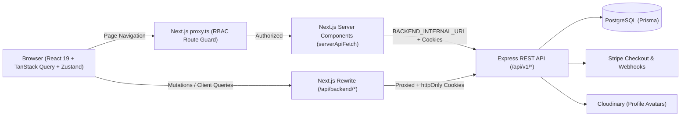
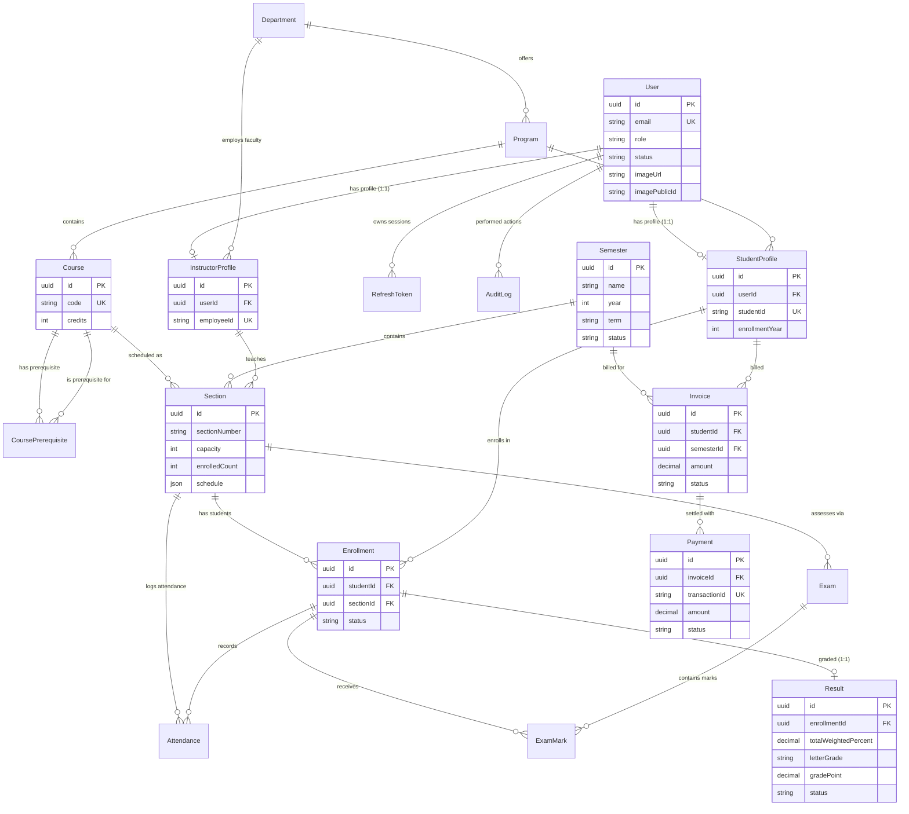

<div align="center">
  
  <h1>UniManage — University Management Portal</h1>
  <p>
    A role-based university academic &amp; financial management platform built with
    <strong>Next.js 16</strong>, <strong>React 19</strong>, <strong>TypeScript</strong>,
    <strong>Tailwind CSS v4</strong>, and <strong>Stripe Checkout</strong>.
  </p>

  <p>
    <a href="https://a07-level-2-university-management-f.vercel.app"><strong>Live Demo</strong></a>
    &nbsp;·&nbsp;
    <a href="https://university-management-backend-indol.vercel.app/"><strong>Backend Live API</strong></a>
    &nbsp;·&nbsp;
    <a href="https://github.com/mjh-shikder/A06-Level-2-University-Management-Backend"><strong>Backend Repository</strong></a>
  </p>

  <p>
    
    
    
    
    
    
  </p>
</div>

---

## Portals at a Glance

| Portal | Scope | Key Capabilities |
| :--- | :--- | :--- |
| **Public & Auth** | `/` · `/programs` · `/login` · `/register` | University overview, searchable degree catalog, tuition FAQ, admissions inquiry, one-click demo login |
| **Admin** | `/admin/*` | Analytics charts, user & role governance, departments, programs, courses & prerequisite graph, semesters, 3-step section wizard, **section result publishing**, tuition invoices, audit log diff viewer |
| **Instructor** | `/instructor/*` | Assigned sections & teaching schedule, printable/CSV student rosters, daily bulk attendance, exam weightage (100% validation), marks grid, draft grade computation |
| **Student** | `/student/*` | Active semester dashboard, course registration (seat capacity & 18-credit limit gauge), drop flow, attendance logs, published grades, printable transcript (SGPA/CGPA), **Stripe Checkout** billing |

---

## System Architecture & Auth Flow

All browser requests stay first-party on the Next.js origin (`/api/backend/*`) and are proxied to the Express backend via `next.config.ts`, keeping `accessToken` and `refreshToken` strictly `httpOnly`.



---

## Database ERD (Backend Schema)

> Mirrors the backend Prisma schema documented in `docs/backend-handoff/DATA_MODELS.md`.



---

## Tech Stack

| Layer | Technologies |
| :--- | :--- |
| **Framework & Runtime** | Next.js `16.4.6` (App Router, Turbopack, `cacheComponents`, `partialPrefetching`, `proxy.ts`), React `19.3.0`, TypeScript `^5` |
| **Styling & UI** | Tailwind CSS `4.3.3`, shadcn/ui (`radix-ui`), Lucide Icons, `next-themes` (light-first glassmorphism + dark mode toggle & Deep Emerald accent) |
| **Data & State** | TanStack Query `^5.108.4`, Zustand `^5.1.0`, `serverApiFetch` & `apiFetch` with deduplicated 401 refresh |
| **Forms & Charts** | React Hook Form `^7.92.0`, Zod `^4.6.7`, `@hookform/resolvers`, Recharts `^3.11.0`, Sonner `^2.0.8`, `date-fns` `^4.4.0` |
| **Tooling** | Biome `^2.6.9`, `pnpm@12.15.0` |

---

## Demo Credentials

The `/login` page includes **One-Click Demo Login** buttons for quick testing:

| Role | Email | Password | Portal Root |
| :--- | :--- | :--- | :--- |
| **Admin** | `admin@university.edu` | `Admin1234!` | `/admin` |
| **Instructor** | `instructor01@university.com` | `Password123!` | `/instructor` |
| **Student** | `student03@university.com` | `Password123!` | `/student` |

---

## Getting Started

### 1. Environment Variables

Copy `.env.example` to `.env.local` and configure:

```env
# Base URL for server-side fetches AND Next.js /api/backend/* proxy rewrites (no trailing slash)
BACKEND_INTERNAL_URL=http://localhost:5000/api/v1

# Public backend URL reference
NEXT_PUBLIC_API_URL=http://localhost:5000/api/v1

# Stripe publishable key (test mode)
NEXT_PUBLIC_STRIPE_PUBLISHABLE_KEY=pk_test_placeholder_key

# Frontend public URL (used for metadataBase and Stripe return URLs)
NEXT_PUBLIC_APP_URL=http://localhost:3000
```

> **Note:** Restart `pnpm dev` after changing `BACKEND_INTERNAL_URL` so `next.config.ts` reloads the `/api/backend/:path*` rewrite rule.

### 2. Install & Run

```bash
pnpm install          # Install dependencies
pnpm dev              # Start dev server at http://localhost:3000
pnpm lint             # Run Biome linter
pnpm tsc --noEmit     # Run strict TypeScript check
pnpm build            # Build production bundle
pnpm start            # Start production server
```

---

## Complete Route Directory (38 Routes)

<details>
<summary><strong>Public &amp; Auth Routes (7)</strong></summary>

- `/` — University landing page & statistics
- `/about` — Institution mission & leadership overview
- `/programs` — Searchable academic programs catalog
- `/tuition-faq` — Tuition, billing, and academic policy FAQ
- `/contact` — Admissions contact & inquiry form
- `/login` — Sign in with RHF/Zod, 429 countdown, and One-Click Demo Logins
- `/register` — Self-registration with role selection

</details>

<details>
<summary><strong>Admin Portal Routes (12)</strong></summary>

- `/admin` — Admin Dashboard overview (StatCards, Recharts, recent audit logs)
- `/admin/users` — User management, role/status updates, and account creation
- `/admin/departments` — Department CRUD
- `/admin/programs` — Academic program CRUD
- `/admin/courses` — Course catalog CRUD
- `/admin/courses/[id]` — Course details & prerequisite management
- `/admin/semesters` — Semester CRUD & status transitions (`UPCOMING -> ACTIVE -> COMPLETED`)
- `/admin/sections` — Section scheduling & 3-step section creation wizard
- `/admin/sections/[sectionId]/results` — Section grade sheet, compute draft, publish & unpublish results
- `/admin/invoices` — Student tuition invoice generation & status filtering
- `/admin/audit-logs` — Searchable system audit trail with before/after JSON diff modal
- `/admin/profile` — Profile info, profile image upload (`PATCH /users/profile-image`), & change password

</details>

<details>
<summary><strong>Instructor Portal Routes (9)</strong></summary>

- `/instructor` — Instructor Dashboard (assigned sections & weekly teaching schedule)
- `/instructor/profile` — Profile info, profile image upload (`PATCH /users/profile-image`), & change password
- `/instructor/sections` — Assigned sections overview
- `/instructor/sections/[sectionId]` — Redirects to section student roster
- `/instructor/sections/[sectionId]/students` — Section student roster with search, CSV export & print
- `/instructor/sections/[sectionId]/attendance` — Daily bulk attendance sheet with optimistic updates
- `/instructor/sections/[sectionId]/exams` — Exam configuration & 100% weight allocation
- `/instructor/sections/[sectionId]/marks` — Marks entry grid & draft grade computation
- `/instructor/sections/[sectionId]/results` — Section gradebook & draft results review

</details>

<details>
<summary><strong>Student Portal &amp; Stripe Payment Routes (10)</strong></summary>

- `/student` — Student Dashboard (active courses, weekly schedule, CGPA badge, unpaid invoice alert)
- `/student/registration` — Course registration catalog with capacity bars & 18-credit limit gauge
- `/student/courses` — Active & past enrolled courses with drop confirmation dialog
- `/student/attendance` — Per-course attendance percentages & dated session logs
- `/student/results` — Published semester letter grades & grade points
- `/student/transcript` — Printable Official Academic Transcript with SGPA & CGPA
- `/student/billing` — Tuition invoices & live Stripe Checkout initiation (`POST /invoices/:id/pay`)
- `/student/profile` — Profile info, profile image upload (`PATCH /users/profile-image`), & change password
- `/payments/success` — Stripe Checkout return verification (polls real invoice status from backend)
- `/payments/cancel` — Stripe Checkout cancellation return page

</details>
